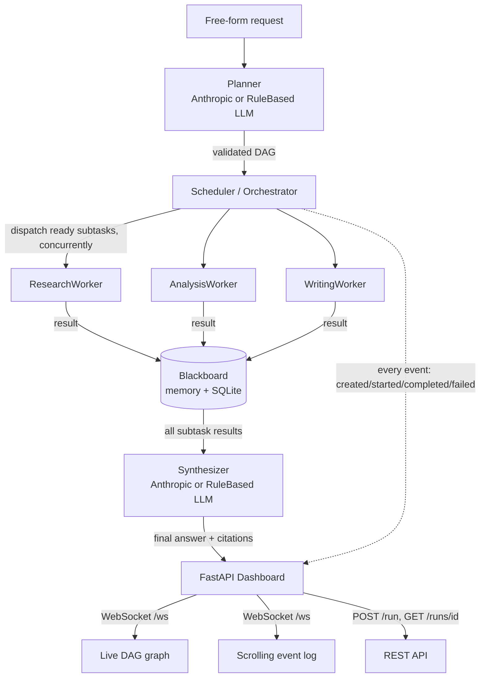

# AI Agent Orchestrator

**Hierarchical multi-agent task orchestration, with a live visual dashboard.**

A `Planner` agent decomposes a free-form request into a DAG of capability-tagged
subtasks. A scheduler walks that DAG, dispatching every subtask whose
dependencies are satisfied to the right typed `Worker` agent, concurrently,
and persists every result on a shared `Blackboard` (in-memory *and* SQLite, so
state survives a restart). Once the DAG resolves, a `Synthesizer` agent writes
a final answer that cites exactly which subtask results it drew on. A FastAPI
dashboard broadcasts every step of that process over a WebSocket and renders
it live: the DAG as a graph of color-coded nodes, and a scrolling event log
underneath.

This is deliberately not a single ReAct-style agent looping over one tool
budget, and not a fixed-role debate between two agents. It is an
*orchestration layer*: a planner that can shape a different graph for every
request, a scheduler that genuinely parallelizes independent subtasks and
genuinely gates dependent ones, three distinct worker types with real
(non-mocked) logic, and a dashboard that makes the whole thing observable
while it runs.

## Why this matters

Production LLM systems rarely look like one model calling tools in a loop.
The moment a task has *parts that don't depend on each other* (look up two
things, run a calculation, then write it up), the efficient and debuggable
shape is a DAG: independent work runs in parallel, dependent work waits only
on what it actually needs, and every intermediate result is a named,
inspectable artifact rather than a line buried in a transcript. That's also
exactly the shape that becomes unmanageable without observability — once a
plan can branch and fan back in, "is it stuck, or just working?" stops being
answerable from logs alone. The scheduler here is intentionally small and
readable (topological readiness checks, not a workflow DSL), and the
dashboard is the other half of the thesis: hierarchical orchestration is only
a good idea if you can *see* the graph execute.

## Architecture

```
                         ┌─────────────┐
      free-form  ─────▶  │   Planner   │   LLM backend: AnthropicLLM (live)
      request            │ (LLM-backed)│   or RuleBasedLLM (offline, deterministic)
                         └──────┬──────┘
                                │ validated DAG of Subtasks
                                ▼
                         ┌─────────────┐
                 ┌───────┤  Scheduler  ├───────┐
                 │       │(Orchestrator)│       │
                 │       └──────┬──────┘       │
     dispatches ready           │              │ persists every
     subtasks concurrently      │              │ status + result
                 ▼              ▼              ▼
          ┌───────────┐  ┌───────────┐  ┌───────────┐
          │ Research  │  │ Analysis  │  │  Writing  │   Worker agents
          │  Worker   │  │  Worker   │  │  Worker   │   (3 distinct types)
          └─────┬─────┘  └─────┬─────┘  └─────┬─────┘
                │               │              │
                └───────────────┼──────────────┘
                                 ▼
                         ┌──────────────┐
                         │  Blackboard  │   in-memory + SQLite
                         │ (shared state)│  (survives a restart)
                         └──────┬───────┘
                                │ every completed subtask result
                                ▼
                         ┌──────────────┐
                         │ Synthesizer  │   LLM backend: same Anthropic /
                         │ (LLM-backed) │   RuleBased pair as the Planner
                         └──────┬───────┘
                                │ final answer + citations ([R1], [A1], ...)
                                ▼
                     ┌────────────────────┐
                     │  FastAPI Dashboard  │  WebSocket event stream +
                     │  (live DAG + log)   │  POST /run, GET /runs/{id}
                     └────────────────────┘
```



### Key design points

- **DAG, not a fixed pipeline.** The Planner can emit any valid dependency
  graph for a given request — two independent research lookups and an
  independent calculation all gating one writing subtask, a long linear
  chain, or a single ungated node. The scheduler doesn't know or care about
  the shape in advance; it only ever asks "which pending subtasks have every
  dependency `done`?"
- **Real concurrency.** Every subtask whose dependencies are satisfied in a
  given pass is dispatched together via `asyncio.gather`, each running in its
  own worker thread (`asyncio.to_thread`). Dependent subtasks are never
  started early.
- **Failure doesn't hang the run.** If a subtask fails, every subtask that
  transitively depends on it is marked failed (`"Skipped: an upstream
  dependency failed."`) rather than waited on forever, so the DAG always
  reaches a terminal state and the Synthesizer still runs over whatever did
  complete.
- **Swappable LLM backend.** `Planner` and `Synthesizer` talk to an
  `LLMBackend` interface, not a concrete provider. `AnthropicLLM` is used only
  when `ANTHROPIC_API_KEY` is set; `RuleBasedLLM` is a fully deterministic,
  offline fallback that decomposes requests via pattern-matching (known
  knowledge-base topics, "average/sum/max/min/median of ..." clauses, a
  "write ..." instruction split) and synthesizes the final answer by
  combining completed subtask results. The entire pipeline — planning,
  dispatch, all three worker types, synthesis — runs and is tested with
  **zero network calls**.
- **Safe arithmetic, not `eval`.** `AnalysisWorker` parses expressions with
  `ast.parse` and walks the tree with a hand-written recursive evaluator that
  only recognizes an allow-list of operators and functions (`sum`, `avg`,
  `max`, `min`, `median`, `product`, `round`, `abs`, `len`). There is no
  `eval`/`exec` anywhere in the module.

## Project structure

```
ai-agent-orchestrator/
├── src/ai_agent_orchestrator/
│   ├── dag.py                 # Subtask + DAG model, cycle/validation logic
│   ├── planner.py             # Planner agent: request -> validated DAG
│   ├── scheduler.py           # Orchestrator: dispatch, dependency resolution, events
│   ├── blackboard.py          # Shared state: in-memory + SQLite persistence
│   ├── synthesizer.py         # Synthesizer agent: cited final answer
│   ├── events.py              # OrchestrationEvent contract
│   ├── knowledge_base.py      # Offline KB loader/matcher shared by worker + planner
│   ├── config.py              # LLM backend selection, DB path, worker delay
│   ├── run.py                 # CLI: python -m ai_agent_orchestrator.run "..."
│   ├── data/knowledge_base.json   # Bundled offline research fixtures (14 topics)
│   ├── llm/
│   │   ├── base.py            # LLMBackend abstraction
│   │   ├── anthropic_llm.py   # Real Anthropic-backed planning + synthesis
│   │   └── rule_based.py      # Deterministic offline fallback (used by tests/CI)
│   ├── workers/
│   │   ├── base.py            # Worker contract
│   │   ├── research.py        # ResearchWorker: offline knowledge-base lookups
│   │   ├── analysis.py        # AnalysisWorker: safe ast-based arithmetic
│   │   └── writing.py         # WritingWorker: compiles cited upstream results
│   └── dashboard/
│       ├── app.py             # FastAPI app factory: WS + REST endpoints
│       ├── server.py          # Production ASGI entry point (uvicorn target)
│       ├── bus.py             # Async pub/sub EventBus for WebSocket clients
│       └── static/index.html  # Self-contained dashboard (HTML/CSS/vanilla JS)
├── tests/                     # DAG, workers, blackboard, scheduler, synthesizer,
│                               # dashboard WS/HTTP contracts, full e2e run
├── .github/workflows/ci.yml   # ruff + pytest on Python 3.11, no secrets/network
├── pyproject.toml / requirements.txt
├── LICENSE (MIT)
└── README.md
```

## Setup

```bash
git clone <this repo>
cd ai-agent-orchestrator
python -m venv .venv
.venv\Scripts\activate          # Windows
# source .venv/bin/activate     # macOS/Linux

pip install -r requirements.txt
pip install -e .
```

By default everything runs on `RuleBasedLLM` — **no API key required, no
network calls**. To use the real Anthropic-backed Planner and Synthesizer
instead, set:

```bash
export ANTHROPIC_API_KEY=sk-ant-...
```

## Running it

### Dashboard (recommended)

```bash
uvicorn ai_agent_orchestrator.dashboard.server:app --reload
```

Then open **http://127.0.0.1:8000** in a browser. Type a request into the
input box (or click one of the example chips) and press **Run**. The task
graph and event log update live as the orchestration executes.

### Headless CLI

```bash
python -m ai_agent_orchestrator.run "Research PostgreSQL and MongoDB, calculate the average of their performance scores (120, 95, 110, 130), and write an executive summary comparing them for a startup choosing a database."
```

Add `--json` to print the full run record (subtasks, results, citations) as
JSON instead of the human-readable summary, or `--quiet` to suppress the
live event trace.

## The dashboard

The dashboard is a single self-contained HTML file (no CDN, no build step,
no framework) served by FastAPI, built around three bands:

1. **Command band** — a textarea + Run button to kick off a new orchestration
   (`POST /run`), example-request chips, and a strip of recent runs (`GET
   /runs`) that can be clicked to reload any past run's graph, log, and final
   answer straight from the Blackboard.
2. **Stat tiles + Task DAG** — live counts of pending / running / done /
   failed subtasks, and the DAG itself as an SVG graph: each subtask is a
   node positioned by dependency depth (left to right), colored by status
   (gray/amber/green/red, with the status *name* always printed as text too,
   never color alone), with a pulsing glow while running and dependency
   arrows drawn between nodes. Hovering a node or a citation chip in the
   final-answer panel cross-highlights the other.
3. **Event log + Synthesized answer** — a scrolling, timestamped log of every
   orchestration event as it streams in over `/ws`, and once the run
   completes, the Synthesizer's final answer with its citation chips.

Every event the scheduler emits (`run_started`, `dag_created`,
`subtask_started`, `subtask_completed`, `subtask_failed`, `run_completed`,
`run_failed` — each with timing) is broadcast to every connected WebSocket
client and persisted to SQLite, so the dashboard and `GET /runs/{id}` are
reading the same event stream, just live vs. replayed.

## Worked example: real captured trace

This is the actual output of a real run against the live server
(`uvicorn ai_agent_orchestrator.dashboard.server:app`), driven through a real
WebSocket client hitting `POST /run` and reading `/ws`, using `RuleBasedLLM`
(no network calls). A small artificial per-subtask delay
(`ORCHESTRATOR_WORKER_DELAY=0.4`) was enabled only so the concurrency is
visible in the timings below — it defaults to `0` and is off during tests.

**Request:**

> Research the key differences between PostgreSQL and MongoDB, calculate the
> average of their relative performance scores (120, 95, 110, 130), and write
> an executive summary comparing them for a startup choosing a database.

**Planner output — the DAG actually produced:**

| id | capability | depends_on |
|----|------------|------------|
| `R1` | research (`postgresql`) | — |
| `R2` | research (`mongodb`) | — |
| `A1` | analysis (`avg([120, 95, 110, 130])`) | — |
| `W1` | writing | `R1`, `R2`, `A1` |

Three independent subtasks feeding one dependent writer — exactly the kind of
graph a single ReAct loop or a fixed two-role debate can't express.

**Captured event trace** (`t+sec` is wall-clock time since the request was
posted):

```
 t+sec  event               subtask  detail
----------------------------------------------------------------------------------------------------
 0.134  run_started         -
 0.134  dag_created         -        R1(research, deps=[]), R2(research, deps=[]),
                                      A1(analysis, deps=[]), W1(writing, deps=[R1, R2, A1])
 0.134  subtask_started     R1       capability=research
 0.134  subtask_started     R2       capability=research
 0.134  subtask_started     A1       capability=analysis
 0.638  subtask_completed   R1       duration=0.468s  topic=postgresql, found=True
 0.638  subtask_completed   R2       duration=0.449s  topic=mongodb, found=True
 0.638  subtask_completed   A1       duration=0.430s  expression=avg([120, 95, 110, 130]) -> 113.75
 0.638  subtask_started     W1       capability=writing
 1.120  subtask_completed   W1       duration=0.426s
 1.120  run_completed       -        citations=[R1, R2, A1, W1]
```

Note the shape: `R1`, `R2`, and `A1` all start at `t=0.134` (one dispatch
batch, genuinely concurrent) and all finish around `t=0.638`; `W1` does not
start until *all three* of its dependencies are `done`, confirming the
dependency gate is real and not just declared.

**Final synthesized answer** (returned from `GET /runs/{run_id}`,
`final_answer` field, verbatim):

```
Request: Research the key differences between PostgreSQL and MongoDB, calculate the average of their relative performance scores (120, 95, 110, 130), and write an executive summary comparing them for a startup choosing a database.

Write an executive summary comparing them for a startup choosing a database.

[R1] PostgreSQL: PostgreSQL is an open-source object-relational database known for strict ACID compliance, a mature SQL feature set, and deep extensibility. Key points: Strict ACID transactions with MVCC concurrency control; Rich support for JSONB, full-text search, and extensions such as PostGIS; Vertical scaling is strong; horizontal write-scaling needs extensions like Citus; Best suited for workloads needing complex joins, strong consistency, and relational integrity.
[R2] MongoDB: MongoDB is a document-oriented NoSQL database that stores data as flexible, JSON-like BSON documents. Key points: Schema-flexible document model well suited to evolving or nested data; Native horizontal scaling via sharding; Tunable consistency: eventual by default, strong with majority write/read concern; Best suited for high write-throughput, denormalized, rapidly-iterating workloads.
[A1] Computed avg([120, 95, 110, 130]) = 113.75.

(Synthesized from subtasks: R1, R2, A1, W1.)
```

`citations: ["R1", "R2", "A1", "W1"]` — every subtask that actually ran is
named, and the claims in the answer are traceable back to the exact subtask
(`[R1]`, `[R2]`, `[A1]`) that produced them.

The run was then confirmed durable: a **brand-new** `Blackboard` instance
pointed at the same SQLite file (simulating a process restart) returned the
identical `status`, `final_answer`, all 4 subtasks, and all 11 persisted
events for `run_id = 5ea18e62096b`.

## Testing

```bash
pytest -q
ruff check .
```

The suite (57 tests, all passing, zero network calls) covers:

- **DAG validation** — valid construction, empty plans, duplicate ids,
  unknown capabilities, self-dependencies, missing dependencies, short and
  long dependency **cycles**, `ready_subtasks` / `blocked_pending` /
  `is_terminal`.
- **Each worker's real logic** — `ResearchWorker` hits/misses against the
  offline knowledge base; `AnalysisWorker`/`safe_eval` correctness *and*
  rejection of anything outside the AST allow-list (`__import__`, attribute
  access, comprehensions, lambdas, bare names); `WritingWorker` compiling and
  citing upstream results.
- **The Blackboard** — create/update/complete round-trips, and persistence
  that survives a simulated restart (a second `Blackboard` instance opened
  against the same SQLite file).
- **The Scheduler** — concurrent dispatch of independent subtasks, a
  dependent subtask only starting after *all* its dependencies complete, and
  failure propagation (a failing subtask correctly fails its dependents
  without the run hanging).
- **The Synthesizer** — citing every completed subtask, and only completed
  subtasks.
- **The rule-based planner** — topic/number/instruction extraction from
  free-form text, and the graceful single-node fallback when a request names
  no known topic and no calculation.
- **The dashboard** — the `/ws` WebSocket contract (the full
  `run_started → dag_created → subtask_started → subtask_completed →
  run_completed` sequence for a real run), `POST /run` + `GET /runs/{id}` +
  `GET /runs` HTTP contracts, and 404/validation edge cases.
- **A full end-to-end run** — the exact worked example above, run through
  `RuleBasedLLM`, asserting the DAG shape, the computed value (`113.75`), the
  citations, and that the result round-trips through a reopened SQLite file.

CI (`.github/workflows/ci.yml`) runs `ruff check .` and `pytest -q` on Python
3.11 with no secrets and no network access beyond `pip install`.

## Scope notes

- The `RuleBasedLLM` planner's natural-language parsing is pattern-based
  (known knowledge-base topics, aggregate keywords + a trailing number list,
  a "write ..." split), not a general NLU system — by design, so the whole
  pipeline is deterministic and network-free. `AnthropicLLM` is a complete,
  real implementation but only exercised when `ANTHROPIC_API_KEY` is set; it
  is never constructed during tests or CI.
- The dashboard intentionally ships as one static HTML file rather than a
  frontend build pipeline, in keeping with "no CDN dependency, no heavy
  framework."

## License

MIT — see [LICENSE](LICENSE). Copyright (c) 2026 Samir Rafigzada.
